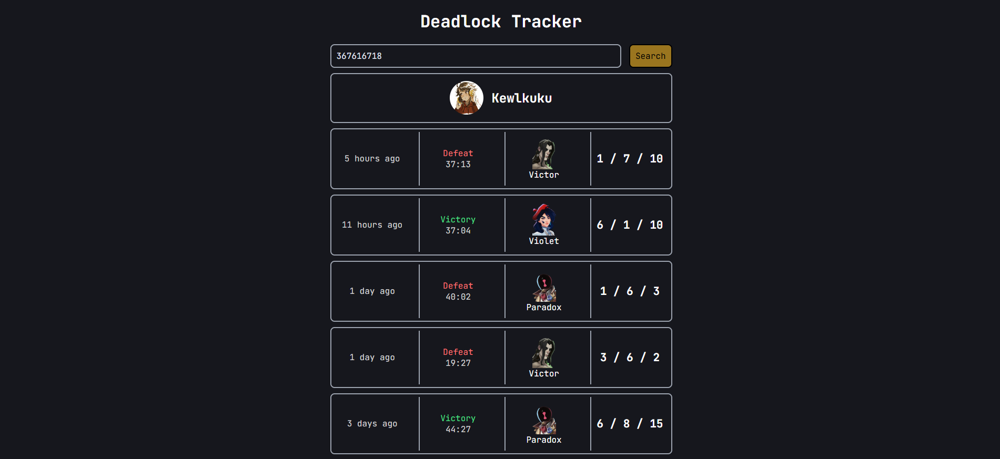

# Deadlock Tracker

Allows you to search a Steam user's profile and see their match history on Deadlock.

**Live site:** https://deadlock-tracker-rho.vercel.app/



## Features

- Search via friend code or SteamID64
- Display player's name and avatar
- Match result, how long ago, hero, duration, K/D/A

## Tech

- React
- Vite
- Deadlock API
- Vercel

## Local Install

**Node.js must be installed already**

```
git clone https://github.com/DavidGuixinPan/DeadlockTracker.git
cd DeadlockTracker
npm install
npm run dev
```

**Note**

- `npm run dev` prints a local address, which can be clicked on to view

## Future Plans

- Search by name
- Extensive match details
- Player stats

## Learned

- Refactoring
  - Moved three repeating effects (profile, matches, heroes) into one reusable hook
- CORS hiding 404s on error responses
  - Found that a 404 showed up as "Failed to fetch" because the API's error responses lack CORS headers, which the browser blocked; handled both error responses
- Handle missing matches
  - Noticed match missing due to the API's stored history by comparing with another site; `force_refetch` fills the match in, but refetch only works once an hour
- Converting from SteamID64 to account ID
  - Using the SteamID64 did not load the account ID; needed to convert it to be searchable by using BigInt since it exceeded normal JS numbers
  - Tells apart the IDs by its length
